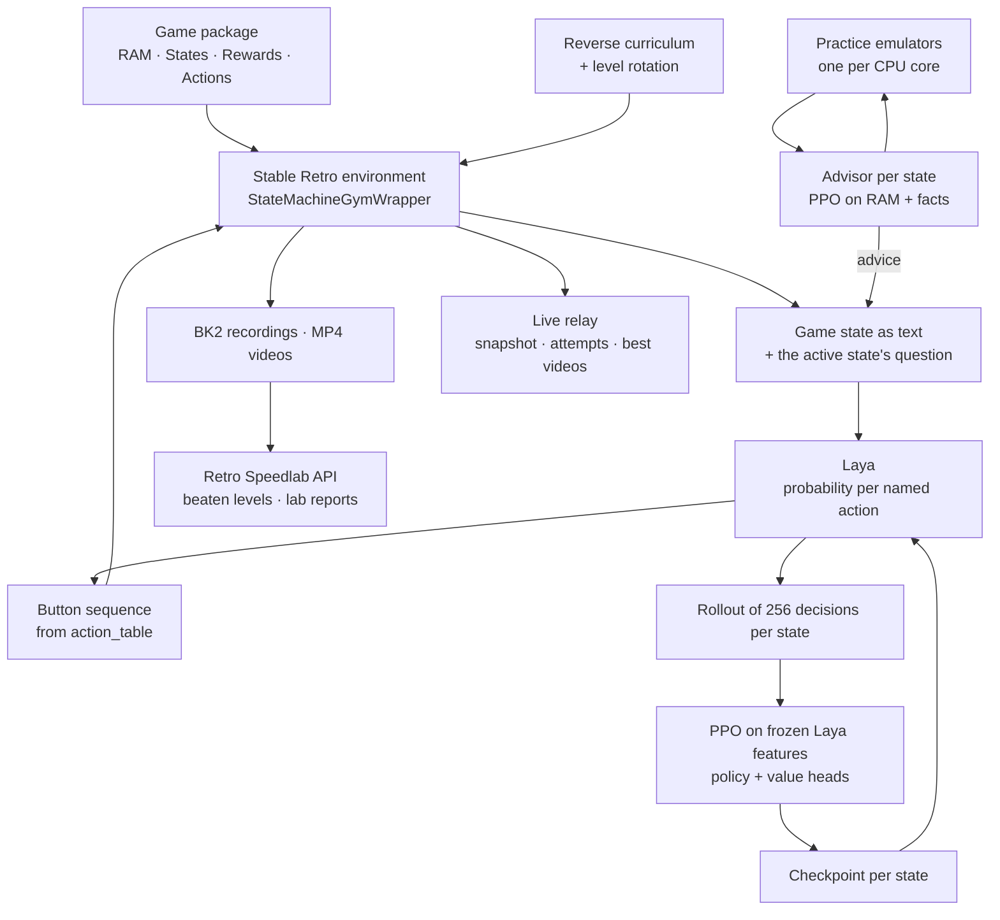

# Retro Speedlab Core

[](https://github.com/datenwissenschaften/retro-speedlab-core/actions/workflows/ci.yml)   [](https://github.com/datenwissenschaften/retro-speedlab-core/commits/main) [](LICENSE)  [](https://codecov.io/gh/datenwissenschaften/retro-speedlab-core)

Training engine for classic video games built entirely on
[Laya](https://huggingface.co/convaiinnovations/laya), a non-autoregressive
decision model. Laya reads the game state as text, answers the active state's
question with calibrated probabilities over named actions, and learns from
rewards by fine-tuning all of its weights with group-relative policy gradients.

Retro Speedlab Core is the engine behind [Retro Speedlab](https://www.retrospeedlab.com),
the lab where Laya learns to beat retro games live on Twitch. Game packages
supply the game knowledge; this repository owns everything that turns that
knowledge into a learning agent.

## Highlights

- **Laya decides every action**: one frozen forward pass reads the game as
  text and scores each named action of the active state; there is no pixel
  encoder
- **A fast advisor coaches Laya**: a small PPO network per state practises on
  every other CPU core at emulator speed; Laya reads its advice as one more
  fact and still makes every decision on the main emulator
- **Route memory**: every forward exit of a state teaches each position on the
  way the move of the fastest one, so Laya and the advisor read what to do
  where they are, next to the live facts about food and enemies
- **A lost life ends the episode**: a game that counts lives in
  `RamInfo.remaining_lives()` ends every attempt on the frame the count drops,
  so the advisor and Laya learn that dying is the end instead of a detour
- **PPO and imitation on Laya's features**: Laya's small policy and value heads
  learn from their own play, the advisor's advice and lab demonstrations
- **One Laya per state**: each phase of a level has its own question and its
  own checkpoint, loaded and prefetched as the state machine moves on
- **Fits a consumer GPU**: the frozen reader runs under fp16 or bf16 autocast,
  and only the heads and the advisors (a few million weights each) are trained
- **Probe and stall watch**: a probe measures which facts Laya can read back
  from its features, and the stream flags states whose learning is flat
- **Power-on start like a real speedrun**: every attempt boots the game at its
  title screen with every button, levels are states of one full-game run
- **Curriculum** with automatic savestates: once a phase is mastered,
  attempts start where the next phase begins; the lab can seed a phase with a
  savestate it played to from power-on
- **Vision helpers** that turn template and color detections into text facts
  and boxes on the stream
- `.bk2` recording of every attempt, MP4 rendering of the best attempts, and
  uploads of beaten levels and short lab reports to the Retro Speedlab API
- Live relay of every attempt, its decisions and the training snapshot to the
  Retro Speedlab backend, whose website plays them as the stream for OBS

## Architecture



A game package subclasses `StateMachineGymWrapper` and supplies a `RamInfo`
for the RAM it understands, the `State` classes of its state machine, an
`action_table` and one description per action. This repository owns the rest:
turning game state into Laya's input, deciding, learning, checkpointing,
curriculum, recording, uploads and telemetry.

## How Laya plays

1. **The game speaks text.** Each `State` returns a `describe()` dict built
   from verified RAM values and detections, for example
   `{"score": 120, "lives": 3, "nearest_enemy": {"direction": "up-left", "distance": 128}}`.
   Positions relative to the player belong in an `Offset(right, down)`, which
   Laya reads as `"34 right, 12 below"`: in the probe it recovered direction
   from such phrases far better than from signed numbers.
2. **Every state asks a question.** A state's `description` is the question
   Laya answers, so "reach the exit" and "survive the boss" are separate
   decisions with separate models.
3. **Every action has a meaning.** `action_table` has the shape
   `(actions, frames, buttons)`: an action is the button sequence played for one
   decision, so a game can tap a button instead of holding it.
   `action_descriptions` name each action, and those names are Laya's options.
4. **Laya decides.** One forward pass returns a probability per option. The
   option order is shuffled deterministically per state text and question, so
   Laya cannot learn a positional bias. The agent samples from a mix of Laya's
   distribution and a uniform one: 5% uniform while a state is being learned,
   1% once it is mastered. The advisors explore on the practice emulators, so
   Laya's own attempts stay precise enough for platforming.

## How the advisor coaches

Every CPU core but two runs a practice emulator without recording. A coach
thread plays them all with one small actor-critic per state (`advisor/`): its
input is the console RAM scaled to `[0, 1]` plus the state's facts hashed into
64 slots, normalized by running statistics. Advisors act and learn on the
accelerator; every 2048 decisions of a state become one PPO update (minibatch
256), with imitation of the lab demonstrations (weight 1 while the state learns,
0.1 once it is mastered, so a mastered stretch is not forgotten). The
coach pauses while a lab run judges its branches and deploys, and saves `advisor.pt` next to
each state's `laya.pt`.

Hard stretches such as precise platforming are learned backwards (backplay).
Replaying the lab's demonstrations from power-on keeps a start point every 4
decisions of each stretch that leaves a state forward. A practice run that ends
in such a state restarts from one of its last start points; once half of 20
attempts leave the state forward, the start moves one point further back, until
the whole stretch is covered. Laya's practice emulators follow their own
backplay depth (`laya_backplay_depth.txt`); the streamed emulator always starts
at the curriculum's start points.
`metadata.advisors.<State>` shows `backplay` (points covered / total) and
`exits` (where practice runs leave the state).

On the main emulator the advisor's top move becomes the first fact in Laya's
text, in the words of that move's option, for example `"advised": "hold right"`.
Laya decides; the advice is only something it reads. Placement matters: as the
first fact in the option's own words, pretrained Laya follows it 97 % of the
time; as `"advisor": "right 82%"` at the end of the facts it managed 27 %, and
imitation only lifted that to 32 %. `advisor_agreement` in
`metadata.state_models` tracks how often Laya's favourite move is the advised one.

## How the route is remembered

A game that knows where the player is returns a `Position` (area, x, y, height,
airborne) from `RamInfo.position()`. Every emulator keeps the trail of positions
and moves of the current state; a respawn (a jump of more than 64 px or a new
area) starts the trail over. When the state is left forward or the game is won,
the trail goes into `<State>/route.json` in the model directory: each 8 px cell
keeps the move of the trail that needed the fewest decisions from there to the
exit. The emulators share the file under a lock and reload it every 10 seconds;
a model reset deletes it with the rest of the model.

The facts then say on the route `"route": "hold right"`, the move of the fastest
pass, and off it `"to_route": "16 left, 4 below"`, the way to the nearest known
cell of the same area. The route is per state, so a phase that eats and a phase
that climbs over the same ground keep different moves. It knows the ground, not
the moment: enemies and food move, so the game's own facts about them decide when
to leave the route. `metadata.routes` counts the known cells per state. A state
that knows the right move gives it as the `move` fact, and the route stays
silent for that step, so Laya never reads two moves that disagree.

A game that returns its life count from `RamInfo.remaining_lives()` ends the
episode on the frame that count drops: the attempt fails, the route trail is
dropped, and the next attempt starts from the state's seed instead of playing on
after a respawn. Games that return `None` play on until their own game over.

## How Laya learns

Laya's reader stays frozen. Each state trains its own small heads with PPO once
256 of its decisions on the main emulator are collected:

- the policy head is a trainable copy of Laya's option scorer and scores every
  option from its marker vector
- the value head reads the pooled vector together with every option's marker
  vector, since the game facts live mostly in the markers
- advantages use GAE (γ = 0.99, λ = 0.95). Losing a life, ending the game or
  leaving the state ends a segment; hitting the time cap only cuts it, so the
  value estimate carries on instead of counting the cap as a death
- 4 epochs of minibatch 64 with ratio clip 0.2, value weight 0.5 and entropy
  bonus 0.01, raised up to tenfold while the state's entropy share is below 5 %;
  policy and value gradients are clipped to norm 0.5 separately so large
  returns cannot starve the policy
- an imitation loss pulls Laya toward the advisor's choice on every decision,
  toward the lab demonstrations and toward its own wins: each attempt that
  leaves a learning state forward is kept (the latest 2048 decisions per state,
  `laya_wins.json`). Learning states imitate with weight 1, mastered ones with 0.1

A state is cut after 180 seconds of game time, counted in emulator frames, so a
slow GPU never shortens what an attempt can achieve. A stalled attempt ends
sooner: once the player has reached no new 8 px spot of the state for 30 seconds
of game time (frames where `GameRam.position()` is `None` never count as stalled).

## One Laya per state

`StateModels` keeps one checkpoint per state under
`models/<game>/<State>/laya.pt`. Each state's heads stay in memory once loaded
(a state without a checkpoint starts from Laya's pretrained scorer). Checkpoints hold the heads,
their optimizer and the trained decision count, and are written on a
background thread to a temporary file that replaces the old one atomically.

## Curriculum and rotation

`ReverseCurriculum` masters the states of a level in order. When an attempt
reaches a new state, the emulator state is saved as that state's checkpoint;
the first win masters a state. Only Laya's attempts on the main emulator count
as wins and failures; the practice emulators only add start points. From then on
attempts start from the checkpoint of the first unmastered state, so Laya
practises the hard part instead of replaying the easy one. Mastery is never
lost; a checkpoint that keeps failing is rebuilt from the nearest earlier
mastered checkpoint.

Once every state of a level is mastered, attempts play the whole level from its
first state until it is beaten once. One lucky win per state does not make the
level chainable, so `LevelDrill` records the state each failed level attempt
ends in. Once 20 are recorded, attempts start at the state where most of them
ended until it passes 3 of 10 tries; then whole-level attempts resume. While
drilled, a mastered state learns like an unmastered one: exploration 0.05 and
full imitation. A drilled state whose entropy share stays below 5 % for 50
updates restarts its heads once from Laya's own judgement.
`metadata.level_drills` shows the endings and the drill.

There are no configured savestates: every attempt that does not start from a
curriculum checkpoint boots the game at power-on, so the menu (one player) is
the first state and every level is a later state of the same run. Stable
Retro's own done conditions are ignored, because they misfire on the title
screen: only the game's states end an attempt (game over). A
`<State>.state` file (the raw bytes of `em.get_state()`) in `paths.curriculum`
seeds that state's checkpoint until the engine saved its own. Once the full
game is won eight times from power-on, every attempt is a speedrun with an
extra cost per frame.

## Vision

States receive every frame. `datenwissenschaften.vision` provides a
`TemplateDetector` (template images from the game's `assets/`), a
`ColorBlobDetector` for sprites with a distinctive color, and
`describe_target`, which turns detections into text such as
`{"visible": true, "direction": "up-left", "distance": 128}`. A state returns
that from `describe()` so it becomes part of what Laya reads, and from
`detections()` so the stream draws the boxes on the replayed video.

## Recordings and uploads

Every attempt is recorded as `.bk2`. After each update, the best attempt per
curriculum state is rendered to MP4. With `upload.api_key` set:

- a level beaten from its very first frame is uploaded to the Retro Speedlab
  API as MP4, with its frame count, frame rate and Laya's model details
- every short lab report (`<report>.summary.json`, the four-line card the
  stream shows) is uploaded whenever it is new or has changed

Failed uploads are retried after the next update; without an API key nothing
is uploaded.

## Live relay

With `ui.enable: true` and an upload key, training records every frame with the
decision behind it and relays it to the Retro Speedlab backend (`upload.url`):
every few seconds the training snapshot and the feed of the latest attempt, the
best replays and the best attempt videos, and each attempt's video and
decisions once, named by their content hash. The website's `/stream` page,
opened with the stream key (`?api_key=`), replays them for OBS. A model reset
requested at the backend (`POST /live/reset`) reaches the training through the
same relay. The engine itself serves nothing. With `twitch.enabled: true`, free
models on OpenRouter (`OPENROUTER_API_KEY`) write the short version of the
latest lab report for the stream.

## Tool-assisted speedrun search

`datenwissenschaften.tas.run` writes a movie of the buttons to press on every
frame from power-on, searched for the fewest frames, independent of Laya:

```bash
python -m datenwissenschaften.tas.run search <wrapper> <config> <until-state> <workers> <segment-seconds>
python -m datenwissenschaften.tas.run improve <wrapper> <config> <workers> <segment-seconds>
```

The run is split at the state machine's transitions. Each segment is searched
Go-Explore style on `<workers>` emulator processes: an archive keeps the fastest
savestate per cell (state, 8 px position, height, airborne and
`RamInfo.dynamics()`, the game's coarse view of whatever moves nearby) and
branches from rarely visited cells with short random input bursts, favouring
cells the route memory knows to be few decisions from the exit. Workers step
the emulator core without rendering. A crossing into a later state ends a
branch; deaths and backward transitions drop it. Of the three fastest distinct
crossings, the one whose next segment is also fastest is kept, and frames it
does not need are shaved off. Random numbers live in the savestates, so the
search plans against the real RNG and can wait frames to change it.

After every segment the whole movie is replayed from power-on; segments that do
not reproduce are searched again. `cache/tas/progress.msgpack` lets a run
resume, `cache/tas/tas.bk2` is the verified movie and `tas.mp4` its video.
Training loads the movie with the demonstrations, so Laya imitates it and
practises from its backplay points. When an attempt in a learning state fails,
a teacher process searches a way out from a savestate taken shortly before the
failure and adds it to Laya's own wins. `improve` searches every segment again, bounded by its
current frames; a faster crossing replaces it and the rest is searched anew.

## Workflows, tracking and the lab duel

[Flyte](https://flyte.org) runs the training as tasks (`datenwissenschaften.workflow`):
`training` trains one two-hour `train_session` after another. `lab` starts a
lab run (`agent/daily.sh` of the game package) once no curriculum win and no
passed level drill happened for `agent.stall_minutes` minutes: Claude Code and Codex each work on their own git
worktree of the game package for `agent.minutes` minutes, and the duel decides which one ships.
Training keeps running while the agents work and pauses only while the duel judges and the
winner deploys; the agents' processes are the first the kernel kills when memory runs out.
While they work, the stream shows each agent's latest actions (only the kind of action and the
source files it touches), its commit subjects with URLs and secret-like words hidden, and the
lines it changed; after the duel it shows the scores and the winner. Every task runs locally with
`flyte run --local` and declares its GPU, so it can move to a Flyte cluster.

With `tracking.token` set, every session is an [MLflow](https://mlflow.org) run
at `tracking.url`. Every attempt counts toward the part it practised, as
`<level>/<part>/progress` (the furthest state it reaches), `<level>/<part>/success`
(1 when it clears the part) and `<level>/<part>/score`, so MLflow groups the
charts by level; a whole level is `<level>/whole level` and a run from power-on
is `Full run`.
Three lines cover the whole session: `decisions_per_second` and
`resident_memory_mb` (the trainer's memory) after every attempt and, after every
learning update, `confidence` (one minus the entropy share of the state that
learned).

The duel (`python -m datenwissenschaften.evaluation.duel <wrapper> <config>
<project>`) plays the trained models greedily with each agent's
branch (`<project>-claude`, `<project>-codex`), starting at the latest curriculum
checkpoint toward the frontier, or at power-on once every state is mastered. Each
branch uses its own integrations and curriculum seeds. It ranks them by wins, then by
how many states its attempts pass beyond the start, then by fewer decisions to get that far, so a branch that adds states is not ranked lower for it. It
logs both agents, the winner and the probability that the winner's attempts
get further (a Mann-Whitney U test with SciPy) to the `<game> A/B` experiment
and prints the winner, or `draw`.

## Persistence

Training state that is not a file (statistics, curriculum progress, the level
rotation and the training identity) lives in one JSON file (`paths.database`)
written atomically. The training identity stores the engine's major and minor
version, `training.fingerprint` and the model layout; when any of them changes,
the models and curriculum of that game are reset instead of resuming into an
incompatible state.

## Installation

Retro Speedlab Core requires **Python 3.12**.

```bash
git clone https://github.com/datenwissenschaften/retro-speedlab-core.git
cd retro-speedlab-core
poetry install
cp config.example.yaml config.yaml
```

The published package and import path are `datenwissenschaften`.

## Minimal usage

This repository does not ship a playable game; a game package supplies the RAM
layout, states, rewards and actions:

```python
from pathlib import Path

import numpy as np

import flyte

from datenwissenschaften.environment.wrapper import StateMachineGymWrapper
from datenwissenschaften.workflow.training import training


class AirstrikerWrapper(StateMachineGymWrapper[AirstrikerRam]):
    start_state_cls = SurviveAndScore
    state_classes = (SurviveAndScore,)
    ram_info_cls = AirstrikerRam
    action_table = np.array([[[1] + [0] * 11, [0] * 12, [0] * 12, [0] * 12]], dtype=np.int8)
    action_descriptions = {"fire": "hold position and shoot straight ahead"}


flyte.init()
flyte.run(training, wrapper="airstriker:AirstrikerWrapper", config="config.yaml")
```

The ROM is imported through Stable Retro from `paths.roms`; the engine's own
test suite needs no ROM.

Before shipping new facts, probe them:

```python
from datenwissenschaften.probe.run import probe

probe(AirstrikerWrapper, Path("config.yaml"), 300, 0)
```

The probe plays the given number of random decisions from every lab seed in
`paths.curriculum` inside a scratch curriculum, then fits a ridge readout from
Laya's features to every numeric fact and logs its held-out R². Any `Offset`
below R² 0.5 raises `UnreadableFacts`.

## Configuration

Every key in `config.example.yaml` is required; missing or malformed values
raise a `RuntimeError` when the configuration is loaded.

| Key | Meaning |
|-----|---------|
| `paths.*` | ROMs, models, recordings, cache, the JSON database, the lab reports and the curriculum seeds |
| `training.game` | Stable Retro game id |
| `training.fingerprint` | Changing it resets the game's models and curriculum |
| `laya.checkpoint` | Laya model on the Hugging Face Hub or a local directory |
| `upload.url`, `upload.api_key` | Retro Speedlab API; `null` disables uploads |
| `ui.*` | Live relay on or off, history size, release label and the persona shown on stream |
| `twitch.enabled`, `twitch.summary_models` | Short lab reports for the stream via OpenRouter |
| `agent.stall_hours` | Hours without a curriculum win before the `lab` task starts a lab run |
| `tracking.url`, `tracking.token` | MLflow server; `null` disables tracking |

## Testing

```bash
poetry run pytest --cov
```

Tests run on CPU with a fake Laya, a fake tokenizer and a scripted emulator, so
they need no GPU, ROM or model download. They cover the learner and trust
region, per-state checkpoints, the curriculum, rotation, uploads, telemetry
and configuration validation.

## Development

```bash
poetry run ruff check .
poetry run ruff format --check .
```

## Relationship to Retro Speedlab

- **Retro Speedlab Core** (this repository): the engine: Laya decisions,
  learning, per-state checkpoints, curriculum, recording, uploads and
  telemetry.
- **Game packages**: one repository per game with its RAM map, states,
  rewards, actions and Dokku deployment, grown daily by scheduled lab runs.
- **[retrospeedlab.com](https://www.retrospeedlab.com)**: the lab's website,
  showing the stream, beaten levels and lab reports uploaded by this engine.

## Limitations

- Training runs one emulator per CPU core, minus two. Laya plays the first
  one, on the stream, and up to three practice emulators (never more than
  half of them) in one batched read per decision, and learns from all of
  them; only the first one counts wins. The other practice emulators are
  played by the advisors at emulator speed (about 750 decisions per second
  with ten practice emulators on a laptop RTX 3060).
- The advisor only knows the RAM and the facts. A state whose reward never
  pays for progress stays flat for both models; the stall watch flags it after
  200 000 decisions.
- Laya only knows what the game package describes. Unmapped RAM, such as an
  enemy that was never measured, is invisible to it.
- Laya's 421M weights stay frozen; a state checkpoint stores only its small
  policy and value heads plus their optimizer, and every state's heads stay in
  memory.
- Training is resumable, not bit-exact reproducible: sampling, CUDA kernels and
  the emulator are not seeded into one deterministic stream.

## License

Copyright © datenwissenschaften contributors.

Distributed under the [GNU General Public License v3.0](LICENSE).
