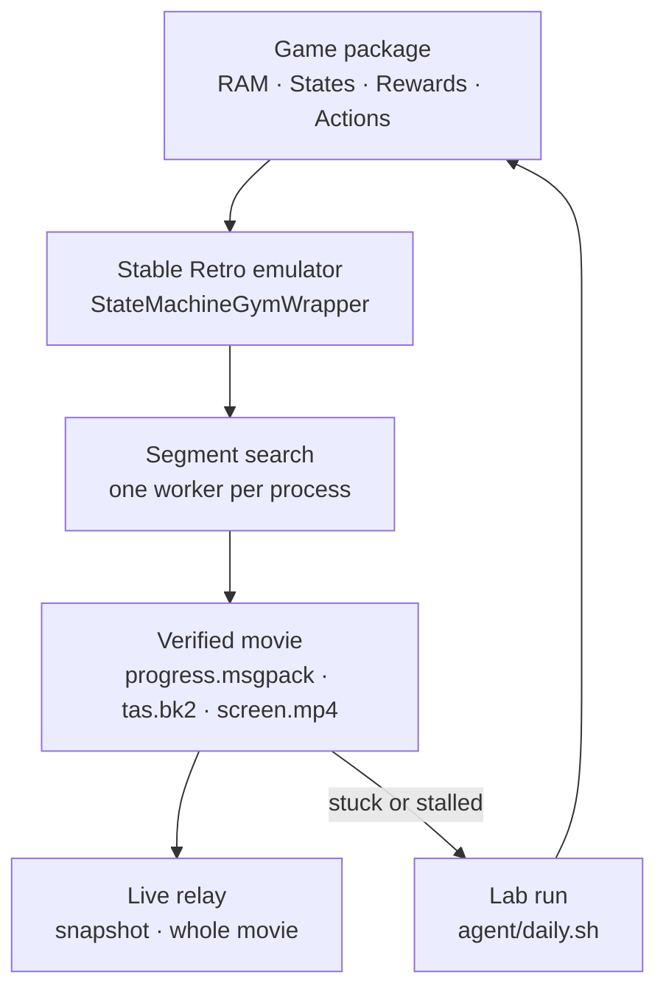

# Retro Speedlab Core

[](https://github.com/datenwissenschaften/retro-speedlab-core/actions/workflows/ci.yml)  [](https://github.com/datenwissenschaften/retro-speedlab-core/commits/main) [](LICENSE)  [](https://codecov.io/gh/datenwissenschaften/retro-speedlab-core)

Tool-assisted speedrun search for classic video games. The engine searches the
fastest movie of buttons to press on every frame from power-on, verifies that it
replays, and streams the run to [Retro Speedlab](https://www.retrospeedlab.com).
Game packages supply the game knowledge (RAM map, states, rewards, actions);
this repository turns it into a speedrun.

## Highlights

- **Power-on start like a real speedrun**: every movie boots the game at its
  title screen; levels are states of one full-game run
- **Every level practised on its own**: the engine keeps the frame before the
  first level change a route makes and loads any level from it; the levels take
  turns of three searches each
- **Three search modes per segment** on many emulator processes: Go-Explore
  walks, a breadth-first frontier search over short input combinations and a
  Monte Carlo tree search
- **Learned guidance**: RAM values never seen before, a move table learned from
  every stored piece, and a PPO policy that trains on the GPU
- **Every segment is verified**: the whole movie replays from power-on before a
  new segment counts
- **Route memory** from the practised levels guides the search towards each
  level's exit
- `.bk2` movie and MP4 video of the verified run
- **Live relay** of the newest verified segment, the run's time, level splits
  and the lab's status to the Retro Speedlab backend
- **Lab runs**: when the search is stuck or stalls, Claude Code improves the
  game package on its own branch

## Architecture



## Speedrun search

The app's default workflow is `speedrun`: it writes the fastest movie from
power-on for any game package and improves it forever:

```bash
python -m datenwissenschaften.tas.run search <wrapper> <config> <until-state>
python -m datenwissenschaften.tas.run improve <wrapper> <config>
python -m datenwissenschaften.tas.run verify <wrapper> <config> <progress>
```

The run is split at the state machine's transitions. Each segment is searched on
`speedrun.workers` emulator processes over an archive that keeps the fastest
savestate per cell (state, 8 px position, height, airborne and
`RamInfo.dynamics()`, the game's coarse view of whatever moves nearby). Three
modes share each search by time:

- **Go-Explore walks** (60 %) branch from rarely visited cells with short input
  bursts; half the time they start from the tenth of cells that earned the most
  of the segment's reward.
- **Frontier search** (20 %) tries every action with holds of 1, 3 and 8
  decisions, three deep and breadth first, from a chosen cell: the frame-precise
  jumps random walks rarely hit.
- **Monte Carlo tree search** (20 %) expands the moves with the best upper
  confidence bound and scores short rollouts by reward and new cells.

Cells gain weight for RAM byte values never seen before in the segment and for
being close to the exit on the route memory. Walks and rollouts follow a move
table learned from every stored piece (`cache/tas/prior.msgpack`) 30 % of the
time and the PPO policy 20 % of the time. A full archive drops its least
promising cell. A crossing into a later state ends a branch and counts only when
the new state holds; deaths and backward transitions drop it. Of the three
fastest distinct crossings, the one whose next segment is also fastest is kept,
and frames it does not need are shaved off. A segment gets
`speedrun.segment_seconds` per round and twice as long with each retry. Random
numbers live in the savestates, so the search plans against the real RNG and can
wait frames to change it. A segment without a way out is marked stuck in
`cache/tas/stuck.json` and the way into it is searched again.

After every segment the whole movie is replayed from power-on; segments that do
not reproduce are searched again. `cache/tas/progress.msgpack` lets a run
resume, `cache/tas/tas.bk2` is the verified movie, `screen.mp4` its video and
`search.log` the search's log. `metadata.speedrun` tells the stream the run's
time from power-on and from Start, its segments, the level splits (from
`GameWrapper.levels`, with the part before the first level split under the
first state's name, `opening`), each state's `goal`, the game and its record
sources, the engine's events, milestones and time history (`journal.json`) and
the segment being searched. While a segment is searched every worker writes its
cells and frames to `live/<seed>.msgpack` every 2 s and its latest frame at half
size to `live/<seed>.jpg` once a second; the main process folds the reports into
`search` every 5 s and the relay puts a mosaic of the first nine workers' frames
(seed order, row by row, seeds in `X-Seeds`) to `/live/attempts.jpg` once a
second. Whenever the verified movie changes a background thread renders it from
power-on to an H.264 MP4 at twice the NES resolution, puts it to
`/live/movie.mp4` in parts, puts the game memory sampled every 6 frames of the
power-on replay to `/live/movie-ram.json` and publishes `speedrun.movie`: its
version (the first 12 hex digits of its SHA-256), frames, seconds, frame rate
and each segment's state, the state it reaches and its start frame, so the
stream plays the whole run in sync with its splits. When `improve` finds a
faster segment, the old and the new piece are rendered side by side from the
same savestate, put to `/live/compare.mp4` and published as `speedrun.compare`
with the state, both frame counts and the time. `improve` searches every segment
again, bounded by its current frames; a faster crossing replaces it and the rest
is searched anew. `verify` fails unless a progress file still replays with a
game package.

## Route memory

`cache/reference/route.json` lists, per 16 px cell of every beaten level, how
many frames the level's route still needed from there to its exit. The search
weights cells on the route by how close they are to the exit, and the file is
rewritten after every level's turn.

## PPO policy

With `speedrun.policy`, a separate process trains a small network (RAM in,
actions and a value out) with PPO on the GPU, always on the level whose turn it
is. `speedrun.policy_emulators` emulator processes play its episodes in
parallel with the network in numpy; every worker process computes with one math
thread, so the search workers and these emulators share the cores evenly. Its reward is the state's reward, RAM values never seen
on that level, a bonus for the exit and a penalty for a death. After every round
of 2048 decisions it exports its weights to `cache/tas/policy.npz`, which the
workers read with numpy.

## Workflows and the lab

[Flyte](https://flyte.org) runs the work as tasks (`datenwissenschaften.workflow`):
`speedrun` relays the stream, publishes the lab's status and searches and
improves the movie forever. `lab` first starts the critic (`agent/critic.sh`)
once five new reports landed in `agent/reports/` since its last review; the
stream shows its lessons as `metadata.critic`. Then it starts a lab run
(`agent/daily.sh` of the game package) once no level stored a piece, the movie
did not improve and no lab run ended for `agent.stall_minutes` minutes, as the
journal records them; a checkpoint is no piece, and a level
resting after its turn does not call the lab, since the next level may move. Claude Code works
for `agent.minutes` minutes on its own git worktree of the game package, and its
branch ships only when its checks pass and the current movie still replays with
it (`tas.run verify`). The lead session delegates to the subagents defined in the
game package's `.claude/agents/`; the stream shows each member's role, state and
latest step and every hand-off with its short task, the lead's latest actions
(only the kind of action and the source files it touches), its commit subjects
with URLs and secret-like words hidden, and the lines it changed. Every task
runs locally with `flyte run --local`.

## Live relay

With `ui.enable: true` and an upload key, the engine relays to the Retro
Speedlab backend (`upload.url`) every few seconds the snapshot (the published
metadata and the release) and the search's newest frame; the whole verified movie
goes up whenever it changes. The website's `/stream` page, opened with the stream
key (`?api_key=`), plays them for OBS.
The engine itself serves nothing.

## Installation

Retro Speedlab Core requires **Python 3.12**.

```bash
git clone https://github.com/datenwissenschaften/retro-speedlab-core.git
cd retro-speedlab-core
uv sync
cp config.example.yaml config.yaml
```

The published package and import path are `datenwissenschaften`.

## Minimal usage

This repository does not ship a playable game; a game package supplies the RAM
layout, states, rewards and actions:

```python
import numpy as np

from datenwissenschaften.environment.wrapper import StateMachineGymWrapper


class AirstrikerWrapper(StateMachineGymWrapper[AirstrikerRam]):
    start_state_cls = SurviveAndScore
    state_classes = (SurviveAndScore,)
    ram_info_cls = AirstrikerRam
    action_table = np.array([[[1] + [0] * 11, [0] * 12, [0] * 12, [0] * 12]], dtype=np.int8)
    levels = ()
```

```bash
python -m datenwissenschaften.tas.run search airstriker:AirstrikerWrapper config.yaml SurviveAndScore
```

Every state sets a one-line `goal`. The ROM is imported through Stable Retro
from `paths.roms`; the engine's own test suite needs no ROM.

## Configuration

Every key in `config.example.yaml` is required; missing or malformed values
raise an error when the configuration is loaded.

| Key | Meaning |
|-----|---------|
| `paths.roms`, `paths.integrations` | ROMs and custom Stable Retro integrations |
| `paths.models` | Route memory per state |
| `paths.cache` | The search's movie, progress, stuck marker, journal, live reports and log under `tas/` |
| `paths.lab_run` | Marker file of a running lab run |
| `training.game` | Stable Retro game id |
| `upload.url`, `upload.api_key` | Retro Speedlab API; `null` disables the relay |
| `ui.enable`, `ui.release` | Live relay on or off and the release label shown on stream |
| `twitch.enabled` | Whether the stream page goes live on Twitch |
| `agent.stall_minutes` | Minutes without a new piece, a faster movie or a lab run before the `lab` task starts one |
| `speedrun.workers`, `speedrun.segment_seconds` | Search processes and seconds per segment round |
| `speedrun.id`, `speedrun.title`, `speedrun.platform` | The game as the stream names it |
| `speedrun.category`, `speedrun.speedrun_com`, `speedrun.tasvideos` | The category run and where its records are read: speedrun.com game, category and variables, TASVideos publication |
| `log_level` | Loguru log level |

## Testing

```bash
uv run pytest --cov=datenwissenschaften --cov-fail-under=95
```

Tests run on a scripted emulator, so they need no ROM.

## Development

```bash
uv run ruff check .
uv run ruff format --check .
```

## Relationship to Retro Speedlab

- **Retro Speedlab Core** (this repository): the engine: segment search,
  verified movies, the live relay and the lab workflow.
- **Game packages**: one repository per game with its RAM map, states,
  rewards, actions and Dokku deployment, improved by lab runs.
- **[retrospeedlab.com](https://www.retrospeedlab.com)**: the lab's website,
  showing the stream and the speedrun.

## License

Copyright © datenwissenschaften contributors.

Distributed under the [GNU General Public License v3.0](LICENSE).
