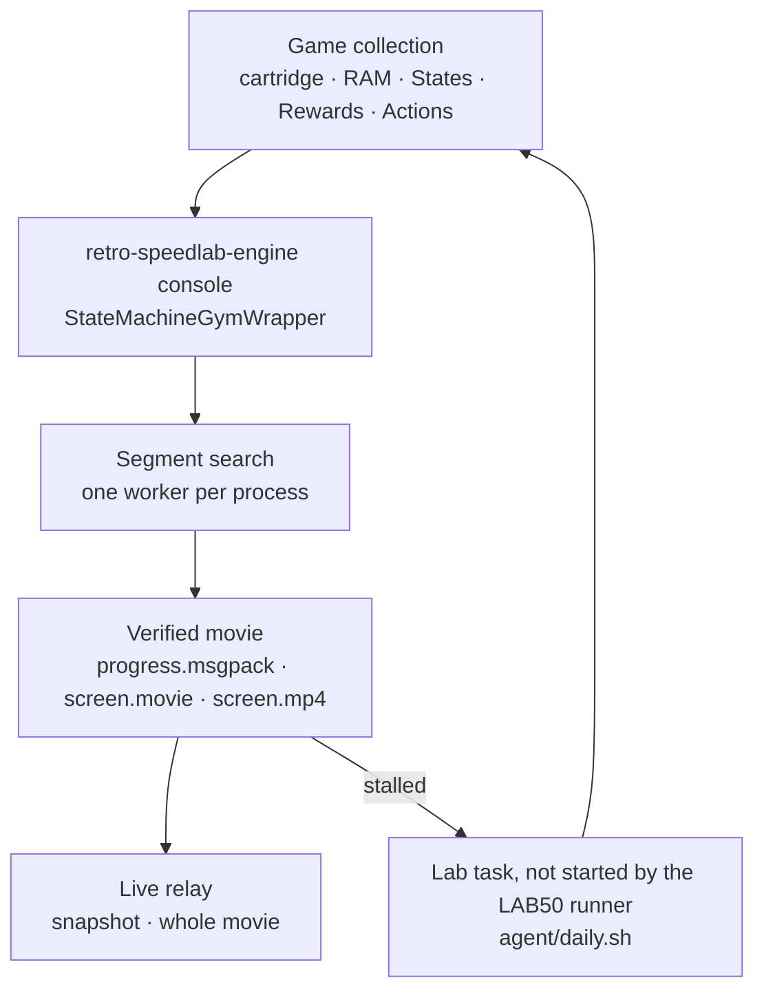

# Retro Speedlab Core

[](https://github.com/datenwissenschaften/retro-speedlab-core/actions/workflows/ci.yml)  [](https://github.com/datenwissenschaften/retro-speedlab-core/commits/main) [](LICENSE)  [](https://codecov.io/gh/datenwissenschaften/retro-speedlab-core)

Tool-assisted speedrun search for Retro Speedlab's own 8-bit games. The search
finds the fastest movie of buttons to press on every frame from power-on,
verifies that it replays, and streams the run to
[Retro Speedlab](https://www.retrospeedlab.com). The games are Python
cartridges of LAB50, a game collection an AI writes, that run on
retro-speedlab-engine, a deterministic 8-bit console; the collection's search package supplies the RAM map, states, rewards and
actions, and this repository turns them into a speedrun.

## Highlights

- **Power-on start like a real speedrun**: every movie boots the game at its
  title screen; levels are states of one full-game run
- **Level by level**: the search stays on the earliest unbeaten level until it is
  beaten, starting where the route of the level before it ends, then moves on
- **Worker roles on many console processes**: Go-Explore scouts (walks, a
  breadth-first frontier search over short input combinations and a Monte Carlo
  tree search), backtrackers, beam scouts, optional vision scouts and polishers
  that search beaten levels again for fewer frames
- **Learned guidance**: RAM values never seen before, a move table learned from
  every stored piece and, with `speedrun.policy` on, a PPO policy that trains on
  the GPU
- **Every segment is verified**: the whole movie replays from power-on before a
  new segment counts
- **Route memory** from the practised levels guides the search towards each
  level's exit
- Movie (`.movie`) and MP4 video with sound of the verified run
- **Live relay** of the newest verified segment, the run's time, level splits
  and the lab's status to the Retro Speedlab backend
- **Lab task**: when the search stalls, Claude Code improves the game package on
  its own branch; the LAB50 runner does not start it

## Architecture



## Speedrun search

The app's default workflow is `speedrun`: it writes the fastest movie from
power-on for any game package and improves it forever:

```bash
python -m datenwissenschaften.speedrun.run search <wrapper> <config> <until-state>
python -m datenwissenschaften.speedrun.run verify <wrapper> <config> <routes>
```

The run is split at the state machine's transitions. Each segment is searched by
`speedrun.scouts` Go-Explore scouts, each on its own console process, over an
archive that keeps the fastest
savestate per cell (state, 8 px position, height, airborne and
`RamInfo.dynamics()`, the game's coarse view of whatever moves nearby). A cell
also keeps the state's memory, so a search that goes on from it earns reward as
the unbroken trail would, never again for ground it already scored, and a life
lost on the trail stays lost. The archive on disk keeps that memory too; a stored
cell without it is not loaded. Three modes share each scout's search by time:

- **Go-Explore walks** (60 %) branch from rarely visited cells with short input
  bursts; half the time they start from the tenth of cells that earned the most
  of the segment's reward.
- **Frontier search** (20 %) tries every action with holds of 1, 3 and 8
  decisions, three deep and breadth first, from a chosen cell: the frame-precise
  jumps random walks rarely hit.
- **Monte Carlo tree search** (20 %) expands the moves with the best upper
  confidence bound and scores short rollouts by reward and new cells.

Alongside the scouts, `speedrun.backtrackers` backtrackers search the same way
from an earlier start of a chain of checkpoints, `speedrun.beam_scouts` beam
scouts keep the 24 best nodes of button chords held for 6, 12 and 24 frames,
and `speedrun.vision_scouts` vision scouts let Claude Haiku (`claude -p`) plan
the next seconds from a screenshot. `speedrun.polishers` polishers search
stored pieces again from cut points inside them, bounded by fewer frames.

Cells gain weight for RAM byte values never seen before in the segment and for
being close to the exit on the route memory. Walks and rollouts follow a move
table learned from every stored piece (`cache/tas/prior.msgpack`) 30 % of the
time and, once it has trained, the PPO policy 20 % of the time. A full archive drops its least
promising cell. Each search process keeps 1000 cells of the last 12 starts it
explored, half with the most reward and half the rarest, and saves them to
`cache/tas/archives/<start>/<process>.msgpack`: a later search from the same
start goes on where the last one stopped, and after a restart the processes'
files are merged. Before it searches a state, the TAS replays the hints for it
from each of its starts in that state: `hints.json` next to the configuration
(the lab's hints, `[{"state": ..., "presses": [[frames, [buttons]]]}]`) and the
shortest way out the PPO policy found (`cache/tas/policy_exits.msgpack`); a hint
that crosses and holds becomes the next piece. A crossing into a later state ends a branch and counts only when
the new state holds; deaths and backward transitions drop it. Of the three
fastest distinct crossings, the one whose next segment is also fastest is kept,
and frames it does not need are shaved off. A segment gets
`speedrun.segment_seconds` per round and twice as long with each retry. Random
numbers live in the savestates, so the search plans against the real RNG and can
wait frames to change it. A segment without a way out is marked stuck in
`cache/tas/stuck.json` (in practice since the state's first failed search
without a find, across the other levels' turns, `cache/tas/failures.json`) and
the way into it is searched again; a search that only ends in a checkpoint counts
as one without a way out too. Checkpoints in a state come only within its first
turn of searches since a piece last left it (practice: one level's turn,
otherwise 3 searches): a chain of checkpoints that has not led out by then is
dropped down to the last piece, unless its end is at least 60 frames closer to
the exit on the route map than its start, or both its start and its end are off the
map; such a chain is searched from its end
again and goes only when the level goes back. Going back drops every checkpoint in a row down
to the last piece as well, and either way that level gets no new checkpoint in
the state it went back from, other than one on the route map, until a piece leaves that state (finding the way
back into it is not enough), also after a restart (`cache/tas/barred.json`).
A checkpoint is the reached cell with the fewest frames left on the route map:
from a start on the map that cell must be at least 60 frames closer to the
exit, from a start off the map any reached map cell will do; otherwise it is
the cell with the most reward. A checkpoint on the map always moves closer to
the exit, so it is also kept after the first turn and in a barred state. A
reward checkpoint from a start off the map is kept after the first turn too, but not in a
barred state, so going back off the map reaches the way into that state; of several workers'
checkpoints the one closest to the exit on the map wins, then the most reward.

After every segment the whole movie is replayed from power-on; segments that do
not reproduce are searched again. `cache/tas/progress.msgpack` lets a run
resume, `cache/tas/screen.movie` is the verified movie, `screen.mp4` its video and
`search.log` the search's log. `metadata.speedrun` tells the stream the run's
time from power-on and from Start, its segments, the level splits (from
`GameWrapper.levels`, with the part before the first level split under the
first state's name, `opening`), each state's `goal`, the game, the search's events, milestones and time history (`journal.json`) and
the segment being searched. While a segment is searched every worker writes its
cells and frames to `live/<seed>.msgpack` every 2 s and its latest frame at half
size to `live/<seed>.jpg` once a second; the main process folds the reports into
`search` every 5 s and the relay puts a mosaic of the first nine workers' frames
(seed order, row by row, seeds in `X-Seeds`) to `/live/attempts.jpg` once a
second. Whenever the verified movie changes a background thread renders it from
power-on with the engine to an H.264 MP4 at twice the console's resolution with
the game's sound, puts it to
`/live/movie.mp4` in parts, puts the game memory sampled every 6 frames of the
power-on replay to `/live/movie-ram.json` and publishes `speedrun.movie`: its
version (the first 12 hex digits of its SHA-256), frames, seconds, frame rate
and each segment's state, the state it reaches and its start frame, so the
stream plays the whole run in sync with its splits. Once every level is beaten,
the search goes over every segment again, bounded by its current frames; a
faster crossing replaces it only when the movie still replays, and the old and
the new piece are rendered side by side from the same savestate, put to
`/live/compare.mp4` and published as `speedrun.compare` with the state, both
frame counts and the time. `verify` fails unless a routes file still replays with a
game package. A piece whose replay now reaches a later state, because the package
split a state inside it, replays under that state, as it does when the search loads
the package.

## Route memory

`cache/route.json` lists, per 16 px cell of every beaten level, how
many frames the level's route still needed from there to its exit, and is
rewritten whenever a level's route changes. A row may end in what the run had there, in
the game's `dynamics()` order; such a row counts only for a run that has at
least as much, so the map leads over pickups and power-ups too. The search weights cells on the route by
the fewest frames left to the exit.

## Sprites and game knowledge

Every cartridge names its sprites (`SPRITES`: name to image bank, x, y, width
and height). Once per game version the engine renders each to a PNG with
colour 0 transparent into `cache/sprites/<version>/`, and
`metadata.speedrun.sprites` publishes them as `[{signature, name, png}]`, the
PNG base64-encoded and `signature` the sprite's name.

Names and the rest of the lab's knowledge come from the optional
`knowledge.yaml` next to `config.yaml`, the lab's file of what the AI learned
about the game. A missing file is empty knowledge; a malformed one
stops the run with the file and the field named. Every key is required, and a
`sprite` names one of the cartridge's `SPRITES`:

```yaml
mechanics: [{title: Thrust, text: Holding A burns fuel.}]
player: {name: Courier, text: The comet courier., sprite: courier}  # or null
enemies: [{name: Drone, text: Flies at the courier., sprite: drone, levels: [1, 2]}]
powerups: [{name: Fuel, text: Fills the tank., sprite: null, effect: More fuel}]
levels: [{name: Level 1, goal: Deliver the parcel, route: Over the ridge, hazards: [rocks]}]
ram: [{address: 0x0010, name: fuel, meaning: Fuel left, verified: true}]
```

`metadata.speedrun.knowledge` publishes the file as it reads.

## Game versions

Games improve over time, and every stored route and the full run remember the
cartridge `VERSION` they were found on. When the search starts on another
version it replays every stored piece from the start the current version
gives it, keeps each piece that still reaches its state, cuts the route at the
first one that breaks and searches on from there; one log line tells how many
pieces still replay. `metadata.speedrun.game` names the collection, the game's
number, slug, title and version.

## PPO policy

The policy is off in `config.example.yaml` and in the LAB50 runner. With `speedrun.policy` and the
optional `vision` dependencies (PyTorch and Stable-Baselines3), a separate process trains a policy with
[Stable-Baselines3](https://stable-baselines3.readthedocs.io) PPO on the GPU, always from the start
the search is working on (`cache/tas/policy_start.msgpack`). `policy.env.PolicyEnv` is a
[Gymnasium](https://gymnasium.farama.org) environment around one console: RAM in, a button
combination out. Its reward is the state's reward, RAM values never seen on that level, a bonus
for the exit and a penalty for a death; an episode ends on the exit, a death, another state or
after 128 decisions. `speedrun.policy_emulators` environments play in parallel in a
`SubprocVecEnv`. After every round of 1024 decisions per console the policy network (two tanh
layers of 256) is exported to `cache/tas/policy.npz`, which the search workers read with numpy,
the shortest episode that left the state is kept for the search to replay, and the round's
reward, exits, entropy and value fit go to Weights & Biases.

## Workflows and the lab

[Flyte](https://flyte.org) runs the work as tasks (`datenwissenschaften.workflow`):
`speedrun` relays the stream, publishes the lab's status and searches and
improves the movie forever. `lab` first starts the critic (`agent/critic.sh`)
once five new reports landed in `agent/reports/` since its last review; the
stream shows its lessons as `metadata.critic`. Then it starts a lab run
(`agent/daily.sh` of the game package) once no level stored a piece, the movie
did not improve and no lab run ended for `agent.stall_minutes` minutes, as the
journal records them; a checkpoint is no piece. Claude Code works on its own
git worktree of the game package, and its branch ships only when its checks pass and the current movie still replays with
it (`speedrun.run verify`). The lead session delegates to the subagents defined in the
game package's `.claude/agents/`; the stream shows each member's role, state and
latest step and every hand-off with its short task, the lead's latest actions
(only the kind of action and the source files it touches), its commit subjects
with URLs and secret-like words hidden, and the lines it changed. Every task
runs locally. The LAB50 runner starts only `speedrun`, and the games
repository has no `agent/` scripts, so no lab runs happen today.

### Experiments

The search and the policy each log one [Weights & Biases](https://wandb.ai) run per release
(project `retro-speedlab`, grouped by `ui.release`, jobs `search` and `policy`):

- **search:** the run from power-on as `run/seconds`, `run/pieces`, `run/levels_beaten` and the state it
  ends in, `run/reached`; every level's split as `levels/<level>`; running counts of `search/found`,
  `search/improved`, `search/checkpoint`, `search/stuck` and `search/lab`; the frames the trimming saved,
  `search/frames_saved`; and with every value `search/hours_since_progress`, the hours since a piece was
  found or made faster;
- **policy:** per PPO round `policy/reward`, `policy/exits`, `policy/episodes`, `policy/exit_rate`,
  `policy/entropy` and `policy/explained_variance`.

Without `WANDB_API_KEY` the runs are disabled and logged as not tracked.

### Lab runs

After the verdict, `python -m datenwissenschaften.lab.record CONFIG LOG STAMP BASE OUTCOME COMMITS`
(outcome `rejected`, `notes` or `deployed`) reads the run's Claude Code log once and

- publishes its numbers and a swimlane timeline (the lead and every subagent as lanes, tool calls as
  blocks, hand-offs as arrows) to the website at `PUT /lab-runs/{game}/{stamp}`;
- sends it to [Langfuse](https://langfuse.com) as the session `lab-run STAMP`, one trace per
  `claude -p` round, as OpenTelemetry spans with their recorded times. Every model turn is a
  generation with its token usage, every tool call a tool span and every subagent an agent span
  holding its own turns and tools. The session is scored with `accepted`, `deployed`, `cost_usd`,
  `commits`, `minutes`, `turns`, `subagents` and `tool_errors`.

Langfuse needs `LANGFUSE_PUBLIC_KEY`, `LANGFUSE_SECRET_KEY` and `LANGFUSE_BASE_URL`; without them the
run is logged as not traced.

## Live relay

With `ui.enable: true` and an upload key, the search relays to the Retro
Speedlab backend (`upload.url`) every few seconds the snapshot (the published
metadata and the release) and the search's newest frame; the whole verified movie
goes up whenever it changes. The stream view at
[stream.retrospeedlab.com](https://stream.retrospeedlab.com), opened with the
stream key (`?api_key=`), plays them for OBS.
Core itself serves nothing.

## Installation

Retro Speedlab Core requires **Python 3.12** and the private
retro-speedlab-engine checked out next to it.

```bash
git clone https://github.com/datenwissenschaften/retro-speedlab-core.git
cd retro-speedlab-core
uv sync
cp config.example.yaml config.yaml
```

The package and import path are `datenwissenschaften`. It is not published to
PyPI; the runner installs it from this repository.

## Minimal usage

This repository does not ship a game; the collection's search package supplies
the RAM layout, states, rewards and actions of each cartridge:

```python
import numpy as np

from datenwissenschaften.environment.wrapper import StateMachineGymWrapper


class CourierWrapper(StateMachineGymWrapper[CourierRam]):
    start_state_cls = Deliver
    state_classes = (Deliver,)
    ram_info_cls = CourierRam
    action_table = np.array([[[0, 0, 0, 0, 0, 0, 0, 1, 0]] * 8, [[0] * 9] * 8], dtype=np.int8)
    levels = ()
```

```bash
python -m datenwissenschaften.speedrun.run search speedrun.comet_courier.wrapper:CourierWrapper config.yaml Deliver
```

Every state sets a one-line `goal`. Actions press the console's buttons in its
order `B, -, SELECT, START, UP, DOWN, LEFT, RIGHT, A`.

## Configuration

Every key in `config.example.yaml` is required; missing or malformed values
raise an error when the configuration is loaded.

| Key | Meaning |
|-----|---------|
| `paths.collection` | The game collection: `collection.yaml` and `games/<slug>/cartridge.py` |
| `paths.models` | Required, but nothing reads it |
| `paths.cache` | The search's movie, progress, stuck marker, journal, live reports and log under `tas/`, the rendered sprites under `sprites/<version>/` |
| `paths.lab_run` | Marker file of a running lab run |
| `training.game` | The game's slug in the collection; its cartridge is `games.<slug>.cartridge` |
| `upload.url`, `upload.api_key` | Retro Speedlab API; `null` disables the relay |
| `ui.enable`, `ui.release` | Live relay on or off and the release label shown on stream |
| `twitch.enabled` | Whether the stream page goes live on Twitch |
| `agent.stall_minutes` | Minutes without a new piece, a faster movie or a lab run before the `lab` task starts one |
| `speedrun.scouts`, `speedrun.backtrackers`, `speedrun.beam_scouts`, `speedrun.vision_scouts`, `speedrun.polishers` | Search processes of each role |
| `speedrun.segment_seconds` | Seconds per segment round |
| `speedrun.policy`, `speedrun.policy_emulators` | PPO policy on or off and its parallel environments |
| `speedrun.category` | The category run |
| `log_level` | Loguru log level |

## Testing

```bash
uv run pytest -q --cov
```

Coverage must stay at 95 % or more. Tests run on a scripted console and on a
demo cartridge.

## Development

```bash
uv run ruff check .
uv run ruff format --check .
uv run pyright
```

## Relationship to Retro Speedlab

- **Retro Speedlab Core** (this repository): the TAS search, verified movies,
  the live relay and the lab workflow.
- **retro-speedlab-engine** (private): the 8-bit console the games run on,
  their movies, videos and browser builds.
- **retro-speedlab-games** (private): LAB50, the game collection an AI writes,
  with every cartridge and its RAM map, states, rewards and actions.
- **retro-speedlab-runner** (private): runs the search for every LAB50 game in
  turn on black-omen.
- **[retrospeedlab.com](https://www.retrospeedlab.com)**: the website with the
  live run; the stream view is at
  [stream.retrospeedlab.com](https://stream.retrospeedlab.com).

## License

Copyright © datenwissenschaften contributors.

Distributed under the [GNU General Public License v3.0](LICENSE).
