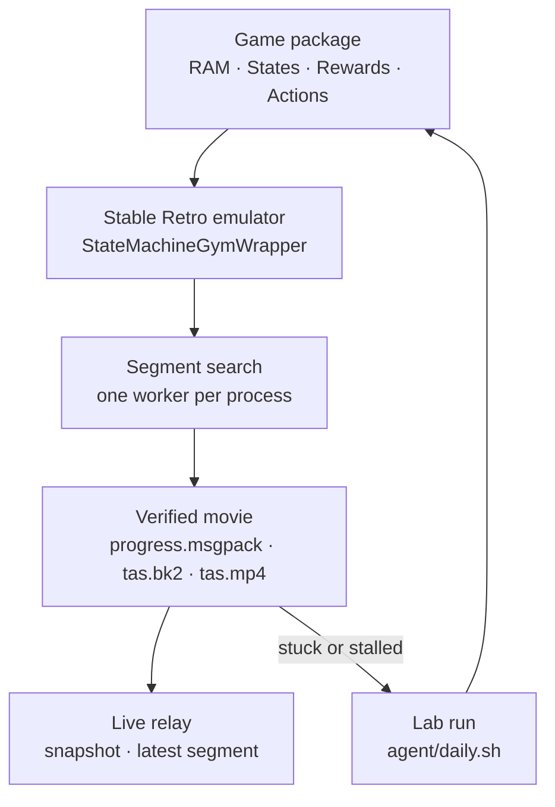

# Retro Speedlab Core

[](https://github.com/datenwissenschaften/retro-speedlab-core/actions/workflows/ci.yml)  [](https://github.com/datenwissenschaften/retro-speedlab-core/commits/main) [](LICENSE)  [](https://codecov.io/gh/datenwissenschaften/retro-speedlab-core)

Tool-assisted speedrun search for classic video games. The engine searches the
fastest movie of buttons to press on every frame from power-on, verifies that it
replays, and streams the run to [Retro Speedlab](https://www.retrospeedlab.com).
Game packages supply the game knowledge (RAM map, states, rewards, actions);
this repository turns it into a speedrun.

## Highlights

- **Power-on start like a real speedrun**: every movie boots the game at its
  title screen; levels are states of one full-game run
- **Go-Explore segment search** on many emulator processes, split at the state
  machine's transitions
- **Every segment is verified**: the whole movie replays from power-on before a
  new segment counts
- **Route memory** from earlier runs guides the search towards a state's exit
- `.bk2` movie and MP4 video of the verified run
- **Live relay** of the newest verified segment, the run's time, level splits
  and the lab's status to the Retro Speedlab backend
- **Lab runs**: when the search is stuck or stalls, Claude Code improves the
  game package on its own branch

## Architecture



## Speedrun search

The app's default workflow is `speedrun`: it writes the fastest movie from
power-on for any game package and improves it forever:

```bash
python -m datenwissenschaften.tas.run search <wrapper> <config> <until-state>
python -m datenwissenschaften.tas.run improve <wrapper> <config>
python -m datenwissenschaften.tas.run verify <wrapper> <config> <progress>
```

The run is split at the state machine's transitions. Each segment is searched
Go-Explore style on `speedrun.workers` emulator processes: an archive keeps the
fastest savestate per cell (state, 8 px position, height, airborne and
`RamInfo.dynamics()`, the game's coarse view of whatever moves nearby) and
branches from rarely visited cells with short random input bursts. Half the time
it branches from the tenth of cells that earned the most of the segment's
reward, and it favours cells the route memory knows to be few decisions from the
exit; a full archive drops its least promising cell. Workers step the emulator
core without rendering. A crossing into a later state ends a branch and counts
only when the new state holds; deaths and backward transitions drop it. Of the
three fastest distinct crossings, the one whose next segment is also fastest is
kept, and frames it does not need are shaved off. A segment gets
`speedrun.segment_seconds` per round and twice as long with each retry. Random
numbers live in the savestates, so the search plans against the real RNG and can
wait frames to change it. A segment without a way out is marked stuck in
`cache/tas/stuck.json` and the way into it is searched again.

After every segment the whole movie is replayed from power-on; segments that do
not reproduce are searched again. `cache/tas/progress.msgpack` lets a run
resume, `cache/tas/tas.bk2` is the verified movie, `tas.mp4` its video and
`search.log` the search's log. `metadata.speedrun` tells the stream the run's
time, its segments, the level splits (from `GameWrapper.levels`), the reference
times in `speedrun.records` and the segment being searched; the newest verified
segment plays as the stream's latest episode. `improve` searches every segment
again, bounded by its current frames; a faster crossing replaces it and the rest
is searched anew. `verify` fails unless a progress file still replays with a
game package.

## Route memory

`paths.models/<game>/<state>/route.json` lists, per 8 px cell, how many
decisions the fastest known run needed from there to the state's exit. The
search weights cells on the route by how close they are to the exit. A state
without the file is searched without guidance.

## Workflows and the lab

[Flyte](https://flyte.org) runs the work as tasks (`datenwissenschaften.workflow`):
`speedrun` relays the stream, publishes the lab's status and searches and
improves the movie forever. `lab` starts a lab run (`agent/daily.sh` of the game
package) at once when the search is stuck, or once the movie has not improved
for `agent.stall_minutes` minutes. Claude Code works on its own git worktree of
the game package, and its branch ships only when its tests pass and the current
movie still replays with it (`tas.run verify`). While it works, the stream shows
its latest actions (only the kind of action and the source files it touches),
its commit subjects with URLs and secret-like words hidden, and the lines it
changed. Every task runs locally with `flyte run --local`.

## Live relay

With `ui.enable: true` and an upload key, the engine relays to the Retro
Speedlab backend (`upload.url`) every few seconds the snapshot (the published
metadata and the release) and the feed of the newest verified segment, whose
video and frame statuses go up once, named by their content hash. The website's
`/stream` page, opened with the stream key (`?api_key=`), plays them for OBS.
The engine itself serves nothing.

## Installation

Retro Speedlab Core requires **Python 3.12**.

```bash
git clone https://github.com/datenwissenschaften/retro-speedlab-core.git
cd retro-speedlab-core
uv sync
cp config.example.yaml config.yaml
```

The published package and import path are `datenwissenschaften`.

## Minimal usage

This repository does not ship a playable game; a game package supplies the RAM
layout, states, rewards and actions:

```python
import numpy as np

from datenwissenschaften.environment.wrapper import StateMachineGymWrapper


class AirstrikerWrapper(StateMachineGymWrapper[AirstrikerRam]):
    start_state_cls = SurviveAndScore
    state_classes = (SurviveAndScore,)
    ram_info_cls = AirstrikerRam
    action_table = np.array([[[1] + [0] * 11, [0] * 12, [0] * 12, [0] * 12]], dtype=np.int8)
    levels = ()
```

```bash
python -m datenwissenschaften.tas.run search airstriker:AirstrikerWrapper config.yaml SurviveAndScore
```

Every state sets a one-line `goal`. The ROM is imported through Stable Retro
from `paths.roms`; the engine's own test suite needs no ROM.

## Configuration

Every key in `config.example.yaml` is required; missing or malformed values
raise an error when the configuration is loaded.

| Key | Meaning |
|-----|---------|
| `paths.roms`, `paths.integrations` | ROMs and custom Stable Retro integrations |
| `paths.models` | Route memory per state |
| `paths.cache` | The search's movie, progress, stuck marker and log under `tas/` |
| `paths.lab_run` | Marker file of a running lab run |
| `training.game` | Stable Retro game id |
| `upload.url`, `upload.api_key` | Retro Speedlab API; `null` disables the relay |
| `ui.enable`, `ui.release` | Live relay on or off and the release label shown on stream |
| `twitch.enabled` | Whether the stream page goes live on Twitch |
| `agent.stall_minutes` | Minutes without a faster movie before the `lab` task starts a lab run |
| `speedrun.workers`, `speedrun.segment_seconds`, `speedrun.records` | Search processes, seconds per segment round and the reference times |
| `log_level` | Loguru log level |

## Testing

```bash
uv run pytest --cov=datenwissenschaften --cov-fail-under=95
```

Tests run on a scripted emulator, so they need no ROM.

## Development

```bash
uv run ruff check .
uv run ruff format --check .
```

## Relationship to Retro Speedlab

- **Retro Speedlab Core** (this repository): the engine: segment search,
  verified movies, the live relay and the lab workflow.
- **Game packages**: one repository per game with its RAM map, states,
  rewards, actions and Dokku deployment, improved by lab runs.
- **[retrospeedlab.com](https://www.retrospeedlab.com)**: the lab's website,
  showing the stream and the speedrun.

## License

Copyright © datenwissenschaften contributors.

Distributed under the [GNU General Public License v3.0](LICENSE).
