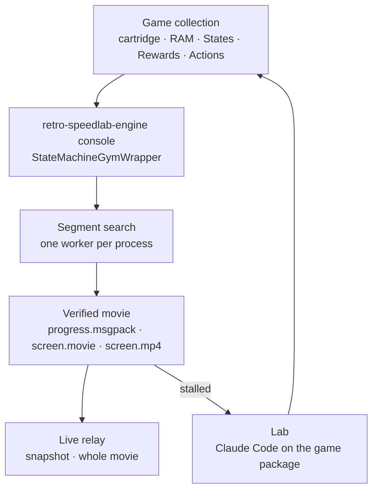

# Retro Speedlab Core

[](https://github.com/RetroSpeedLab/retro-speedlab-core/actions/workflows/ci.yml)  [](https://github.com/RetroSpeedLab/retro-speedlab-core/commits/main) [](LICENSE)  [](https://codecov.io/gh/RetroSpeedLab/retro-speedlab-core)

Tool-assisted speedrun (TAS) search for the games of
[Retro Speedlab](https://www.retrospeedlab.com). The search finds the fastest
sequence of button presses from power-on to the end of a game, verifies that it
replays, and relays the run to the live stream.

The games are LAB24, a collection of Python cartridges written by an AI that run
on retro-speedlab-engine, a deterministic 8-bit console. Each game's search
package supplies the RAM map, states, rewards and actions; this repository turns
them into a speedrun. Nothing in it is specific to one game.

## Highlights

- **Power-on start**: every movie boots the game at its title screen; levels are
  states of one full-game run.
- **Level by level**: the search works on the earliest unbeaten level, starting
  where the previous level's route ends.
- **Worker roles**: Go-Explore scouts, backtrackers, beam scouts, optional vision
  scouts (Claude Haiku plans from a screenshot) and polishers, each on its own
  console process.
- **Learned guidance**: RAM novelty, a move table learned from every stored
  piece, a route map of beaten levels and an optional PPO policy on the GPU.
- **Verified**: the whole movie replays from power-on before a new segment
  counts; a record is replayed again at every start.
- **Lab**: when the search stalls, Claude Code improves the game's search
  package; a change ships only when its checks pass and the movie still replays.

## Architecture



## How the search works

The run is split at the state machine's transitions, and each segment is
searched separately:

1. **Archive.** Every worker keeps the fastest savestate per cell (state, 8 px
   position, height, airborne and the game's `RamInfo.dynamics()`). Archives are
   saved per start, so a later search continues where the last one stopped.
2. **Exploration.** Scouts split their time between Go-Explore walks from rarely
   visited cells, a breadth-first frontier search over short input holds, and a
   Monte Carlo tree search. Beam scouts, backtrackers and polishers search the
   same segment from other starts or bounds. Random numbers live in the
   savestates, so the search plans against the real RNG.
3. **Crossing.** A branch counts when it crosses into a later state and the new
   state holds; deaths and backward transitions drop it. Unused frames are shaved
   off.
4. **Checkpoints.** When a segment has no way out, the search may keep a
   checkpoint that is closer to the exit on the route map or earns more reward,
   and continue from there. Segments without progress are marked stuck and the
   way into them is searched again.
5. **Verification.** After every segment the whole movie is replayed from
   power-on; segments that do not reproduce are searched again.
6. **Improvement.** Once every level is beaten, every segment is searched again
   with its current frames as the bound. A faster piece replaces the old one only
   if the movie still replays.

When a game's cartridge `VERSION` changes, every stored piece is replayed on the
new version; the route is cut at the first piece that breaks and the search
continues from there.

### Outputs

All state lives under `paths.cache`:

| File | Content |
|------|---------|
| `tas/progress.msgpack` | Resumable search progress |
| `tas/screen.movie`, `tas/screen.mp4` | The verified movie and its video with sound |
| `tas/record.msgpack` | The fastest won run from power-on |
| `tas/archives/<start>/<process>.msgpack` | Saved archives per start and process |
| `tas/prior.msgpack` | Move table learned from stored pieces |
| `tas/stuck.json`, `tas/failures.json`, `tas/barred.json` | Stuck states, failed searches and states barred from new checkpoints |
| `tas/journal.json` | Events, milestones and time history |
| `route.json` | Frames left to the exit per 16 px cell of every beaten level |
| `sprites/<version>/` | The cartridge's `SPRITES` rendered to PNG |

The lab's hints are read from `hints.json` next to the configuration.

### Game knowledge

An optional `knowledge.yaml` next to the configuration holds what the lab learned
about the game. A missing file is empty knowledge; a malformed one stops the run.
Every key is required, and `sprite` names one of the cartridge's `SPRITES`:

```yaml
mechanics: [{title: Thrust, text: Holding A burns fuel.}]
player: {name: Courier, text: The comet courier., sprite: courier}
enemies: [{name: Drone, text: Flies at the courier., sprite: drone, levels: [1, 2]}]
powerups: [{name: Fuel, text: Fills the tank., sprite: null, effect: More fuel}]
levels: [{name: Level 1, goal: Deliver the parcel, route: Over the ridge, hazards: [rocks]}]
ram: [{address: 0x0010, name: fuel, meaning: Fuel left, verified: true}]
```

## PPO policy

With `speedrun.policy: true` and the `vision` extra (PyTorch and
[Stable-Baselines3](https://stable-baselines3.readthedocs.io)), a separate process
trains a PPO policy on the GPU from the start the search is working on.
`policy.env.PolicyEnv` is a [Gymnasium](https://gymnasium.farama.org) environment
around one console: RAM in, a button combination out. After every round the
policy is exported to `tas/policy.npz`, which the search workers read with numpy,
and the shortest exit it found becomes a hint for the search.

Each round is logged to [Weights & Biases](https://wandb.ai) (project
`retro-speedlab`) and published as a `policy.rounds` event; every 50 rounds the
policy is stored as a versioned `policy-<game>` model artifact. Without
`WANDB_API_KEY` tracking is disabled.

## Lab

[Flyte](https://flyte.org) tasks in `datenwissenschaften.workflow` run the work
locally. `speedrun` runs the search and the live relay. `lab` starts the game
package's critic once enough new reports arrived, and a lab run when the search
has not improved for `agent.stall_minutes`. Claude Code works on its own git
worktree of the game package; its branch ships only when the checks pass and
`speedrun.run verify` still replays the current movie.

`python -m datenwissenschaften.lab.record CONFIG LOG STAMP BASE OUTCOME COMMITS`
reads a finished run's Claude Code log and

- publishes its numbers and a swimlane timeline of the lead agent and its
  subagents to the website (`PUT /lab-runs/{game}/{stamp}`);
- sends it to [Langfuse](https://langfuse.com) as a session with one trace per
  round, scored with outcome, cost, commits, duration, turns, subagents and tool
  errors. Langfuse needs `LANGFUSE_PUBLIC_KEY`, `LANGFUSE_SECRET_KEY` and
  `LANGFUSE_BASE_URL`.

## Events

The search and the policy publish events through `events.sink`, a
`module:attribute` called with `events.options` that returns an object with
`publish(topic, key, payload)`. With `sink: null` nothing is published. The key is
the game's slug; every payload carries `game` and `at`.

| Topic | Published | Payload |
|-------|-----------|---------|
| `runs.attempts` | every finished search and polisher job | `state`, `seed`, `role`, `seconds`, `worker_seconds`, `outcome` (`crossing`, `checkpoint`, `nothing`), `crossings`, `frames`, `reached` |
| `runs.steps` | every step of the search | `kind` (`found`, `checkpoint`, `stuck`, `improved`, `lab`, `unverified`), `state`, `frames`, `saved`, `role`, `worker_seconds` |

`role` is the worker kind (`scout`, `backtracker`, `beam-scout`, `vision-scout`, `polisher`) and `worker_seconds` the
wall time its worker spent on the job. A `found` or `improved` step names the job whose crossing it took; the other
steps have no worker and carry `null`.
| `runs.records` | a new record that replays from power-on | `version`, `frames`, `seconds`, `pieces`, `previous_frames` |
| `policy.rounds` | every PPO round | `run`, `round`, `steps`, `reward`, `exits`, `episodes`, `exit_rate`, `entropy`, `explained_variance`, `loss` |

## Live relay

With `ui.enable: true` and an upload key, the search sends its snapshot, newest
frames, the verified movie and its RAM trace to the backend at `upload.url`. With
`ui.live: false` it only reports its snapshot to `/games/{game}/snapshot`, so the
website shows its run while another game is on stream. The stream view at
[stream.retrospeedlab.com](https://stream.retrospeedlab.com) plays it for OBS.
Core itself serves nothing.

## Quick start

Requires **Python 3.12**, [uv](https://docs.astral.sh/uv/) and the private
retro-speedlab-engine checked out next to this repository.

```bash
git clone https://github.com/RetroSpeedLab/retro-speedlab-core.git
cd retro-speedlab-core
uv sync
cp config.example.yaml config.yaml
```

The import path is `datenwissenschaften`; the package is not published to PyPI.
A game's search package subclasses the wrapper:

```python
import numpy as np

from datenwissenschaften.environment.wrapper import StateMachineGymWrapper


class CourierWrapper(StateMachineGymWrapper[CourierRam]):
    start_state_cls = Deliver
    state_classes = (Deliver,)
    ram_info_cls = CourierRam
    action_table = np.array([[[0, 0, 0, 0, 0, 0, 0, 1, 0]] * 8, [[0] * 9] * 8], dtype=np.int8)
    levels = ()
```

Every state sets a one-line `goal`. Actions press the console's buttons in the
order `B, -, SELECT, START, UP, DOWN, LEFT, RIGHT, A`.

```bash
python -m datenwissenschaften.speedrun.run search speedrun.comet_courier.wrapper:CourierWrapper config.yaml Deliver
python -m datenwissenschaften.speedrun.run verify <wrapper> <config> <routes>
```

## Configuration

Every key in `config.example.yaml` is required; missing or malformed values fail
when the configuration is loaded.

| Key | Meaning |
|-----|---------|
| `paths.collection` | The game collection: `collection.yaml` and `games/<slug>/cartridge.py` |
| `paths.models` | Required; currently unused |
| `paths.cache` | Search state, live reports, logs and rendered sprites |
| `paths.lab_run` | Marker file of a running lab run |
| `training.game` | The game's slug in the collection |
| `upload.url`, `upload.api_key` | Retro Speedlab API; `null` disables the relay |
| `ui.enable`, `ui.live`, `ui.release` | Relay on or off, on stream or snapshot only, and the release label |
| `twitch.enabled` | Whether the stream page goes live on Twitch |
| `agent.stall_minutes` | Minutes without progress before the `lab` task starts a lab run |
| `speedrun.scouts`, `speedrun.backtrackers`, `speedrun.beam_scouts`, `speedrun.vision_scouts`, `speedrun.polishers` | Search processes per role |
| `speedrun.segment_seconds` | Seconds per segment round, doubled with each retry |
| `speedrun.policy`, `speedrun.policy_emulators` | PPO policy on or off and its parallel environments |
| `speedrun.category` | The category run |
| `events.sink`, `events.options` | Event sink and its options; `null` publishes nothing |
| `log_level` | Loguru log level |

## Checks

```bash
uv run ruff check .
uv run ruff format --check .
uv run pyright
uv run pytest -q --cov
```

Coverage must stay at 95 % or more. Tests run on a scripted console and a demo
cartridge.

## Related repositories

- **retro-speedlab-core** (this repository): the TAS search, verified movies, the
  live relay and the lab workflow.
- **[retro-speedlab-lakehouse](https://github.com/RetroSpeedLab/retro-speedlab-lakehouse)**:
  Kafka, Spark and Delta Lake over the search's events.
- **retro-speedlab-engine** (private): the 8-bit console, its movies, videos and
  browser builds.
- **retro-speedlab-games** (private): the LAB24 cartridges and their search
  packages.
- **retro-speedlab-runner** (private): runs the searches for the collection and
  schedules lab runs.
- **[retrospeedlab.com](https://www.retrospeedlab.com)**: the website with the
  live run.

## License

Copyright © datenwissenschaften contributors.

Distributed under the [GNU General Public License v3.0](LICENSE).
